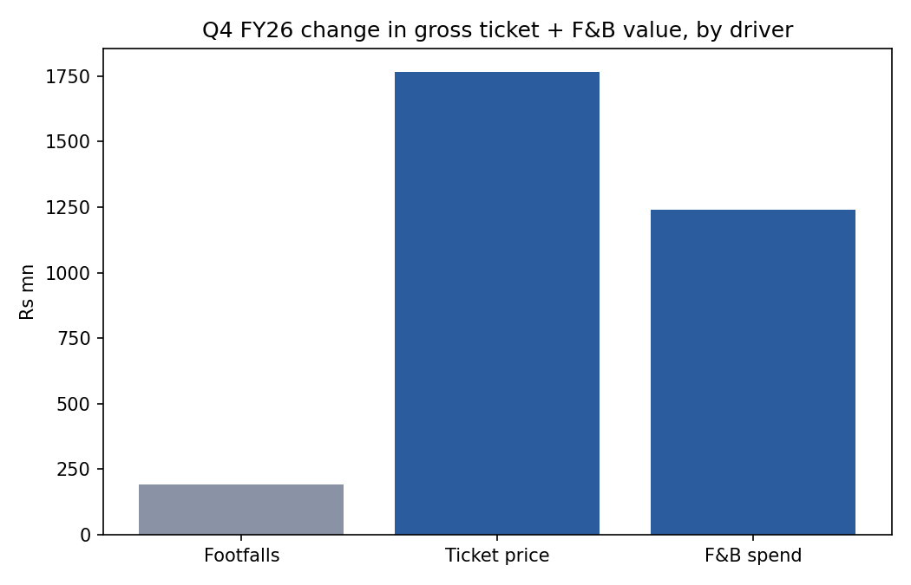
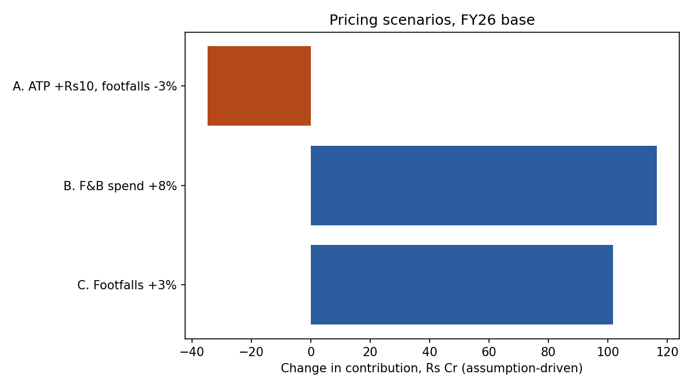

# Where is PVR INOX's growth coming from, and where is the pricing headroom? (Q4 FY26)

## The answer
In Q4 FY26, **about 94% of the growth in gross ticket-plus-F&B value came from higher ticket prices and food spend, not more viewers.** Footfalls rose about 1.6% (30.5 to 31.0 million), average ticket price rose about 22% (Rs 258 to Rs 315) and spend per head on food rose about 32% (Rs 125 to Rs 165). Occupancy is still only 23.9%.

**Recommendation:** grow food spend and footfalls before raising ticket prices further. Under the stated assumptions, a Rs 10 ticket rise loses money if footfalls fall by more than about 2%, while an 8% lift in food spend adds about Rs 116 Cr of contribution and 3% more footfalls adds about Rs 102 Cr. Raise prices selectively, by screen type and show time.

## How confident am I
- The bridge is arithmetic on reported figures and is reliable, though one quarter was blockbuster-driven and the mix may not repeat.
- The scenario sizes depend on three assumptions that are **not** PVR INOX disclosures: 45% of net box office goes to distributors, F&B cost of goods is 30%, and footfalls fall 3% after a price rise. The Excel model has a break-even and sensitivity table for these.

## Repo contents
- `PVR_INOX_Pricing_Model.xlsx`: data, revenue bridge, scenarios, break-even and sensitivity (live formulas).
- `data/pvr_metrics.csv`: the inputs.
- `analysis/analysis.py`: reproduces the bridge, scenarios and charts (`pip install -r requirements.txt`, then `python analysis/analysis.py`).
- `DATA_LOG.md`: where the data came from and every cleaning step.
- `SOURCES.md`: source list.
- `docs/`: slide deck PDF.

## Assumptions and limitations
- Q4 FY25 ATP and SPH are derived from reported year-on-year growth rates.
- Reported ATP and SPH appear to be quoted gross of tax (our inference), so the model applies a net-realisation factor derived from reported segment revenue.
- One quarter of data. Cost splits are assumptions.
- Some figures come from press coverage of the results and should be checked against the original investor presentation.
- This is a student analysis, not investment advice.

## Process
Built with AI assistance (Claude), with data compiled from public results disclosures. Author: Gourang Chandrakar, B.Tech Biomedical Engineering, MIT Manipal.
